# 프레임을 넘어, 우리를 만나다 — V2 스토리보드 정리

2026 한국폴리텍대학 정수캠퍼스 시각디자인과 졸업전시 웹사이트
정리한 날: 2026-11-12 · 이미지 17장 (`img/` 폴더)

---

## 한눈에 보는 흐름

```
s1 나비 등장 → s2 포스터 위로 비행 → s3 입구 + [입장하기]
   → s4 슬로건 타이포 모션 → s5 로비(방 3개 고르기)
   → s6 UX/UI 전시관 / Visual 전시관 (나비 1인칭 + 스크롤 비행)
   → s7 스페셜룸 (대표 작품 랜덤 감상)
   → s8 학생 리스트 (15명 모두, 검색·분야 선택)
```

| 장면 | 무엇이 보이나 | 무엇으로 만드나 | 이미지 |
|---|---|---|---|
| s1 | 하얀 화면에 나비 등장 | 힉스필드 영상 | 1장 |
| s2 | 미술관 벽 포스터 위로 나비가 지나감 | 힉스필드 영상 | 1장 |
| s3 | 빛나는 아치 입구, 나비, [입장하기] 버튼 | 영상 + 웹 버튼 | 1장 |
| s4 | 선이 글자를 이어 주는 슬로건 모션 | 웹 (SVG + GSAP) | 5장 |
| s5 | 아치 3개가 있는 로비 | 웹 (Three.js 또는 이미지) | 1장 |
| s6 | 나비 눈으로 날아다니는 전시관 | 웹 (Three.js + 스크롤) | 4장 (v1·v2 × UX/UI·Visual) |
| s7 | 어두운 방, 작품 썸네일 랜덤 | 웹 | 3장 |
| s8 | 석고상 카드가 줄지어 있는 목록 | 웹 (HTML/CSS) | 1장 |

> 쉽게 말하면: **s1~s3은 "영화"**, **s4부터는 "웹사이트"**예요. 영화는 힉스필드로 만들고, 웹은 코드로 만들어요. 영화의 마지막 장면(아치)과 웹의 첫 장면(로비 아치)을 똑같이 맞추면 이음새가 안 보여요.

---

## s1. 나비 등장

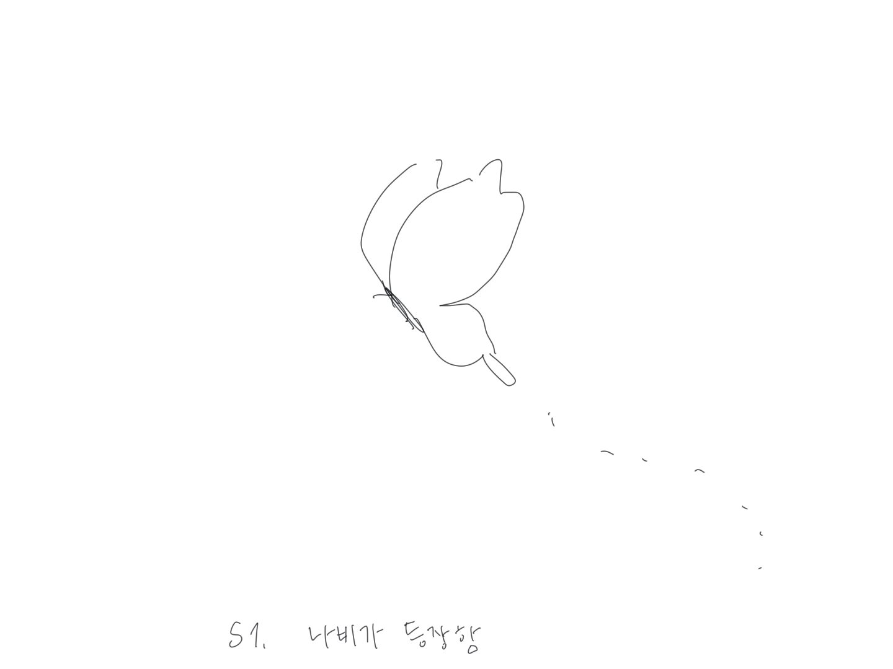

**장면 이야기**
하얀 화면에 나비 한 마리가 점선 길을 따라 날아 들어와요. 이 나비가 전시 여행 내내 길잡이가 돼요.

**구현 메모**
- 힉스필드 영상으로 만들고, 웹에서는 `<video>`로 재생해요.
- 화면 구석에 **[건너뛰기]** 버튼을 항상 둬요.
- "움직임 줄이기"를 켠 사람에게는 영상 대신 멈춘 이미지 한 장 + [입장하기]만 보여 줘요.
- 첫 화면 용량 목표 3~5MB → 영상은 짧게(5~8초), 720p, WebM + MP4 두 가지로 압축해요.

---

## s2. 포스터 위로 날아가는 나비

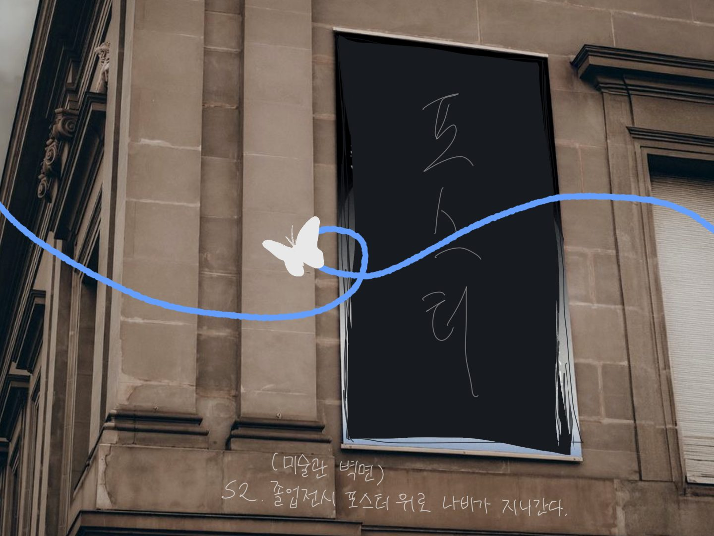

**장면 이야기**
돌로 된 미술관 벽에 졸업전시 포스터가 붙어 있어요. 파란 선처럼 나비가 포스터 앞에서 한 바퀴 돌고 지나가요.
(그림 속 손글씨: "(미술관 벽면) S2. 졸업전시 포스터 위로 나비가 지나간다.")

**구현 메모**
- s1과 이어지는 힉스필드 영상이에요. 파란 선이 나비가 날아가는 길이에요.
- 포스터 안의 글자(제목, 날짜)는 영상에 굽지 말고 **웹 글자로 위에 얹는 것**도 고려해요. 그러면 날짜가 바뀌어도 영상을 다시 안 만들어도 돼요.

---

## s3. 빛나는 입구와 [입장하기]

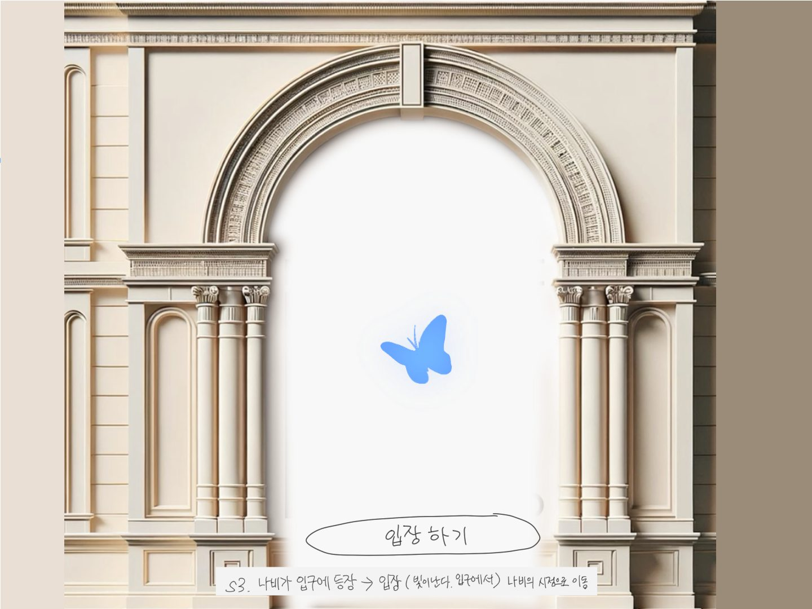

**장면 이야기**
크림색 돌 아치 입구 한가운데에 나비가 떠 있고, 아래에 **[입장하기]** 버튼이 생겨요. 입구는 빛나요. 누르면 나비가 빛 속으로 들어가고, 화면이 나비의 눈(1인칭)으로 바뀌어요.
(손글씨: "S3. 나비가 입구에 등장 → 입장 (빛이 난다. 입구에서) 나비의 시점으로 이동")

**구현 메모**
- 영상은 아치 장면에서 **멈춰서 반복**(루프)하고, [입장하기]는 웹 버튼(HTML)으로 얹어요. 키보드 Tab과 Enter로도 눌러져야 해요.
- 누르면: 짧은 "빛 속으로" 영상 → 하얗게 밝아짐(화이트 페이드) → s4.
- 영상 마지막 아치 구도 = 웹 로비 첫 구도 (같은 카메라 높이, 같은 아치 모양).

---

## s4. 슬로건 "프레임을 넘어 우리를 만나다"

| ① | ② | ③ |
|---|---|---|
| 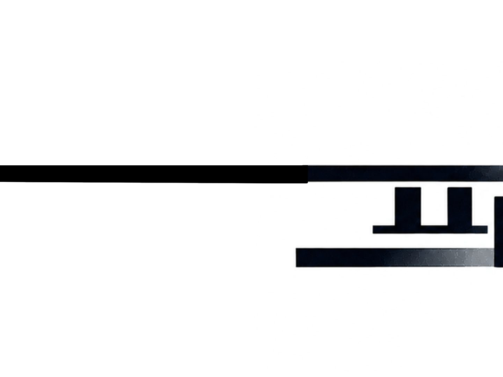 |  | 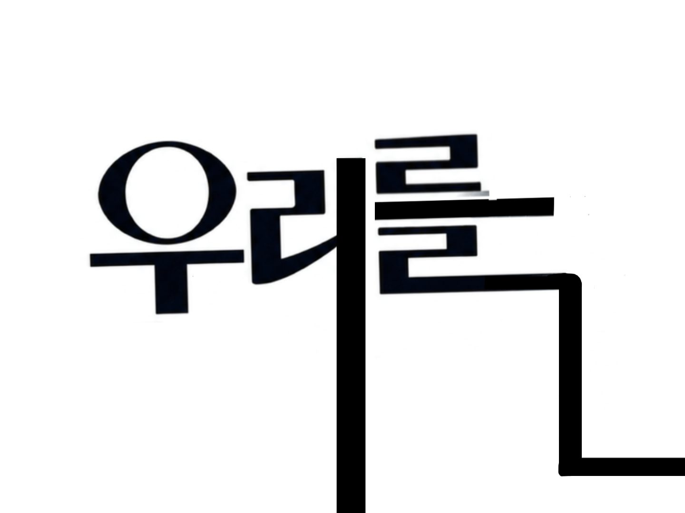 |
| **④** | **⑤** | |
|  | 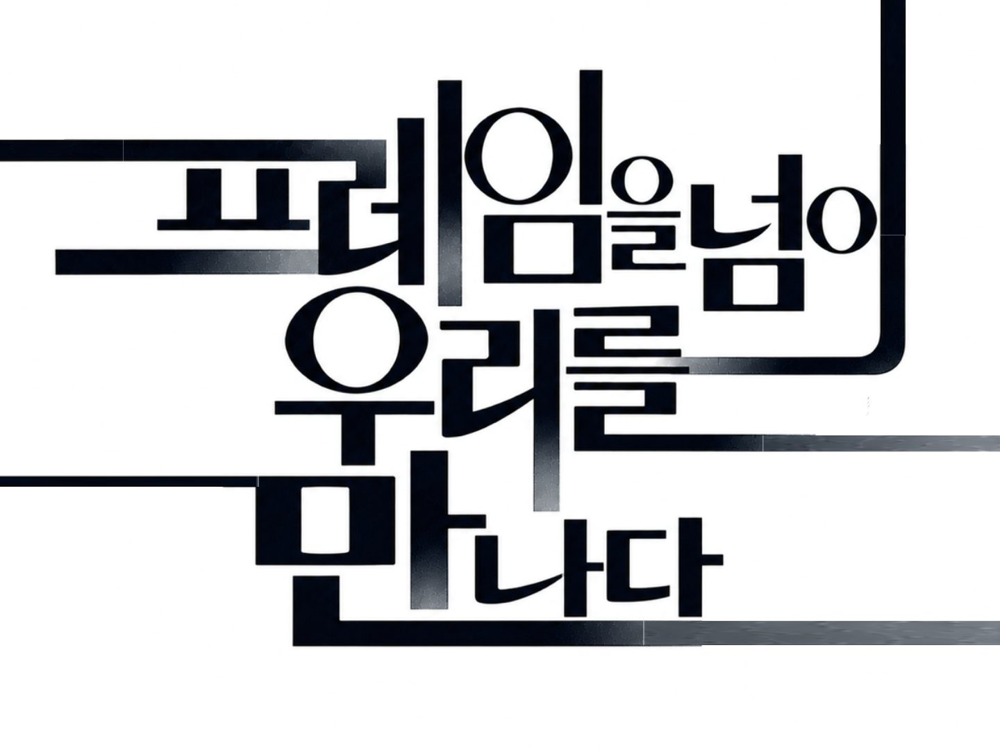 | |

**장면 이야기**
하얀 바탕에 굵은 검은 선이 그려지면서 글자를 이어 줘요. 카메라가 선을 따라가듯 옆으로, 아래로 움직여요.
1. 선이 오른쪽에서 들어오며 "프"가 보여요.
2. "레임을 넘어" — 선이 글자 아래를 지나 위로 꺾여요.
3. "우리를" — 세로 선과 계단 모양 선이 이어져요.
4. "만나다" — 선이 글자 밑을 지나가요.
5. 카메라가 뒤로 빠지면서 세 줄이 한 덩어리로 완성돼요.

선 끝이 회색으로 번지는(그라데이션) 부분이 "빛"처럼 보여서 s3의 빛과 이어져요.

**구현 메모**
- 글자와 선을 **하나의 큰 SVG**로 만들어요(피그마에서 내보내기).
- 선은 `stroke-dashoffset` 애니메이션으로 "그려지게", 카메라 이동은 SVG 전체를 `transform`으로 옮기고 확대·축소해요.
- GSAP 타임라인 하나로 ①→⑤ 순서를 묶어요. 스크롤로 움직일지, 자동 재생 + [건너뛰기]로 할지는 선택이에요. **추천: 자동 재생 6~8초 + 건너뛰기** (s1~s3 영상 흐름과 이어지니까요).
- 움직임 줄이기: ⑤ 완성 그림만 보여 주고 1초 뒤 로비로.

---

## s5. 로비 — 방 3개 중 고르기

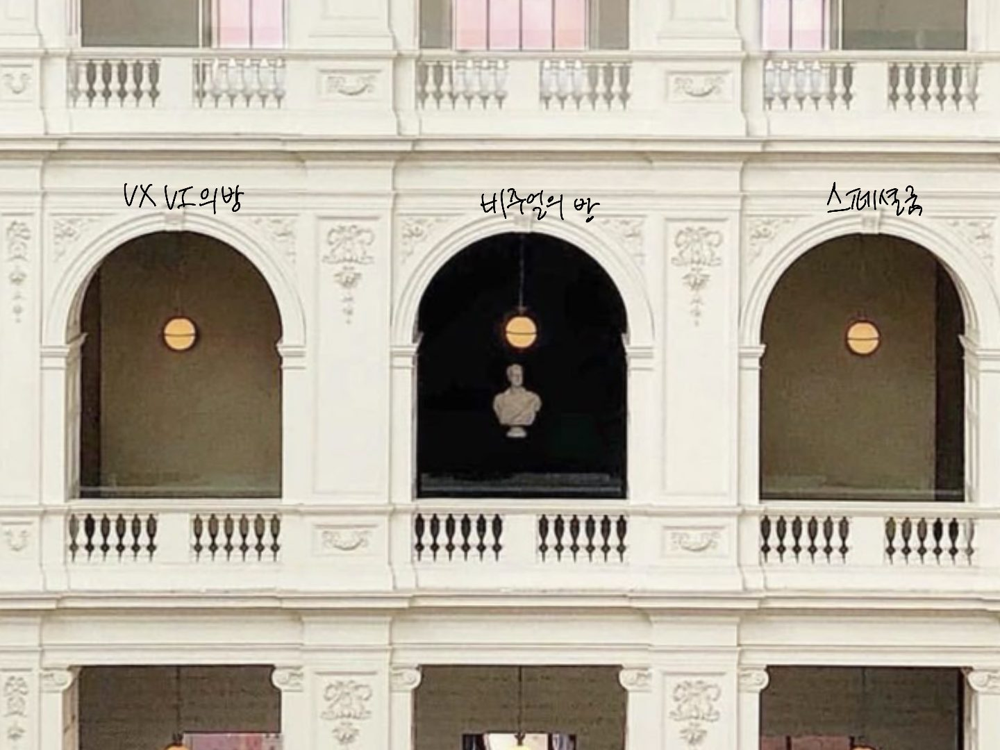

**장면 이야기**
하얀 석조 건물 안, 아치 3개가 나란히 있어요. 각 아치 안에 둥근 등이 하나씩 켜져 있어요.
- 왼쪽: **UX/UI의 방**
- 가운데: **비주얼의 방** (석고상 하나가 보여요)
- 오른쪽: **스페셜룸**

**구현 메모**
- 아치에 마우스를 올리면 등이 밝아지고 이름이 떠요. 클릭하면 그 방으로 날아 들어가요.
- 아치 3개는 **HTML 버튼으로도** 똑같이 만들어서 키보드·화면낭독기 사용자도 고를 수 있게 해요.
- 화면 위에는 항상 메뉴: HOME · GALLERY 01(UX/UI) · GALLERY 02(Visual) · GALLERY 03(Special) · LIST (s8 그림의 메뉴와 같게).
- 모바일: 3D 로비 대신 아치 카드 3장 + "전체 학생 바로가기" 버튼.

---

## s6. 전시관 (UX/UI · Visual) — 두 버전 비교

### 버전 1 — 밝은 현대 미술관

| UX/UI v1 | Visual v1 |
|---|---|
| 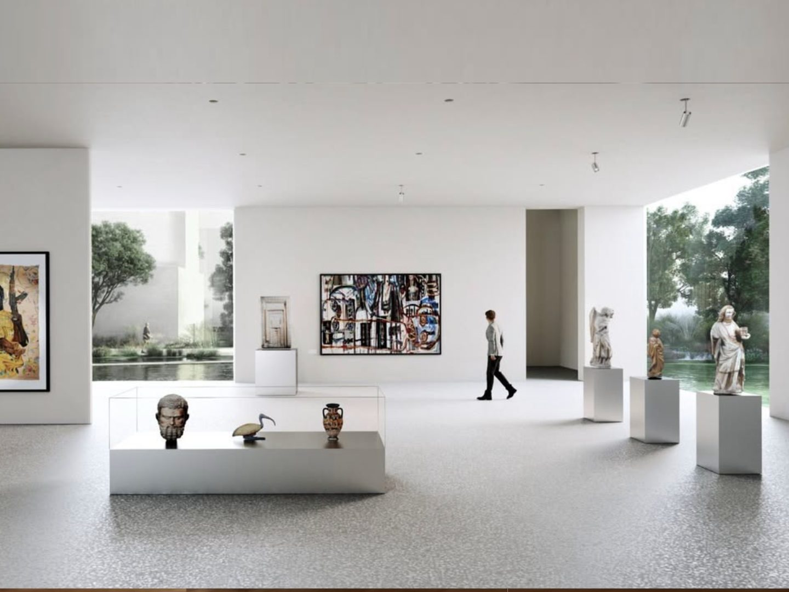 | 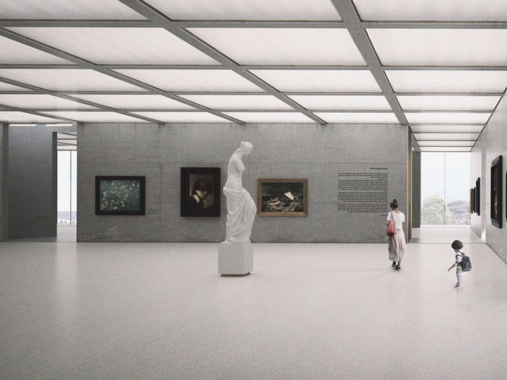 |

- UX/UI v1: 하얀 벽, 회색 돌바닥, 하얀 받침대 위 조각들, 유리 진열장, 큰 창밖 초록 풍경.
- Visual v1: 회색 콘크리트 벽, 격자 천장에서 부드러운 빛, 가운데 하얀 석고상 하나, 벽에 액자 작품.

### 버전 2 — 고전 미술관 + 큰 타이포

| UX/UI v2 | Visual v2 |
|---|---|
| 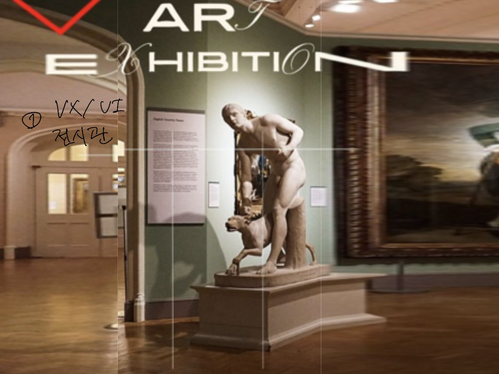 | 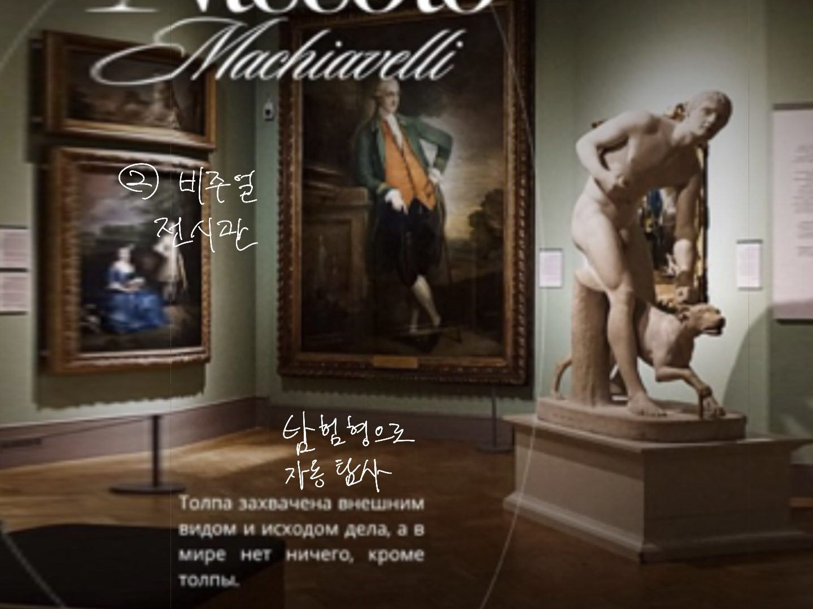 |

- 초록 벽, 나무 바닥, 금 액자, 근육질 조각상. 화면 위에 "ART EXHIBITION", "Machiavelli" 같은 **큰 영문 글자와 가는 선**이 겹쳐져 있어요.
- 손글씨: "① UX/UI 전시관", "② 비주얼 전시관", "**탐험형으로 자유 탐사**".

### 참고 사이트에서 가져올 것

- **Magische Spiegelungen** (https://www.magische-spiegelungen.de) — "그림 속 세상으로 들어가 보는" 가상 갤러리예요. 모바일·데스크톱·VR에서 열려요. 가져올 점: **작품 앞에 다가가면 그 작품 세계로 빨려 들어가는 느낌**.
- **Wonderland Amsterdam** (https://wonderlandams.com) — 첫 화면에 "Scroll to discover"(스크롤해서 발견하기)가 있고, 스크롤이 이야기를 끌고 가요. 가져올 점: **스크롤 = 앞으로 가기**라는 단순한 약속, 로딩 퍼센트 화면.
- 두 사이트 모두 자바스크립트로만 열리는 사이트라서, 제가 글자만 읽어 온 정보예요. 직접 열어서 스크롤해 보는 것을 추천해요.

**3D WebGL을 쓸 수 있을까?** → **네.** 지금 프로젝트는 이미 Three.js(WebGL)를 쓰고 있고, 시험 방(PR #1)에서 "스크롤하면 나비가 곡선을 따라 날고, 기둥 뒤 석고상이 반쯤 보일 때 멈추는" 기능이 만들어져 있어요. 그대로 키우면 돼요.

### 비교표

| 기준 | 버전 1 (밝은 현대) | 버전 2 (고전 + 타이포) |
|---|---|---|
| 기획서의 "밝은 돌 회색, 아치, 기둥, 부드러운 빛" | 거의 그대로 맞아요 | 초록 벽·나무 바닥이라 다름 |
| s5 로비(하얀 석조 아치)와 이어짐 | 색이 같아서 자연스러움 | 색이 갑자기 바뀜 |
| 석고상이 주인공으로 보이나 | 하얀 공간에 하얀 석고상 = 깔끔, 대신 조명으로 그림자를 꼭 줘야 함 | 배경이 진해서 석고상이 잘 보임 |
| Three.js로 만들기 | 상자·판·기둥 같은 단순한 모양 → **쉬움, 가벼움** | 금 액자·몰딩·나무결 → 사진 같은 질감 필요 → **어렵고 무거움** |
| 용량 (전시관 추가 10~20MB 목표) | 지키기 쉬움 | 넘기 쉬움 |
| "자유 탐사" | 스크롤 레일이라 해당 없음 | 자유롭게 걷기는 스크롤 조작과 맞지 않음 |
| 분위기·임팩트 | 차분함, 밋밋해질 위험 | 영화 같고 강렬함 |

### 추천: **버전 1의 공간 + 버전 2의 타이포 연출**

- **공간은 버전 1**: 밝은 돌 회색, 격자 천장 빛(Visual v1), 하얀 받침대 위 석고상. 여기에 로비와 같은 **아치와 기둥**을 더해서 s5와 이어지게 해요.
- **연출은 버전 2에서 빌려요**: 석고상 앞에 도착해서 멈추면, 화면 위에 **학생 이름이 큰 글자 + 가는 선**으로 떠올라요(v2의 "ART EXHIBITION"처럼). 이 선은 s4 슬로건의 선과 같은 스타일로 맞추면 전체가 하나로 묶여요.
- **"자유 탐사" 대신 "정해진 길 + 둘러보기"**: 스크롤로는 정해진 곡선을 따라 가고, 멈춘 자리에서 마우스를 살짝 움직이면 고개를 조금 돌리듯 시점이 흔들려요(±5도). 1인칭 게임 같은 느낌은 살리고 길을 잃지 않아요.
- **두 전시관 차이는 빛으로**: UX/UI관은 창밖 자연광 느낌(조금 따뜻), Visual관은 천장 격자 빛(조금 차가움).

이유: 기획서의 색·재료와 맞고, 로비와 이어지고, 이미 만든 시험 방 코드를 그대로 키울 수 있고, 용량 목표를 지키기 쉬워요. 버전 2의 강렬함은 3D가 아니라 **글자와 선**에서 오기 때문에 그 부분만 가져오면 돼요.

**구현 메모**
- 스크롤 아래 = 곡선 따라 앞으로, 위 = 같은 길로 뒤로, 손 멈추면 그 자리에 멈춤.
- 기둥을 지나면 다음 석고상이 서서히 드러남. 두 번째 석고상이 기둥 뒤로 반쯤 보일 때 한 번 멈춤.
- 석고상 클릭(또는 Enter) → 학생 소개 창. 열리면 비행 멈춤, 닫으면 **같은 위치 + 같은 키보드 초점**으로 복귀.
- 소개 창 → [포트폴리오 보기]는 새 탭.
- 학생 수: UX/UI 7명, Visual 4명 확인됨, 4명은 분야 미정(김준서, 김우선, 조민영, 조예빈). 확정되면 데이터 파일만 고치면 돼요.

---

## s7. 스페셜룸 — 대표 작품 랜덤 감상

| ① 썸네일 구(공) | ② 휘어진 띠 | ③ 어두운 방 + 금 액자 |
|---|---|---|
| 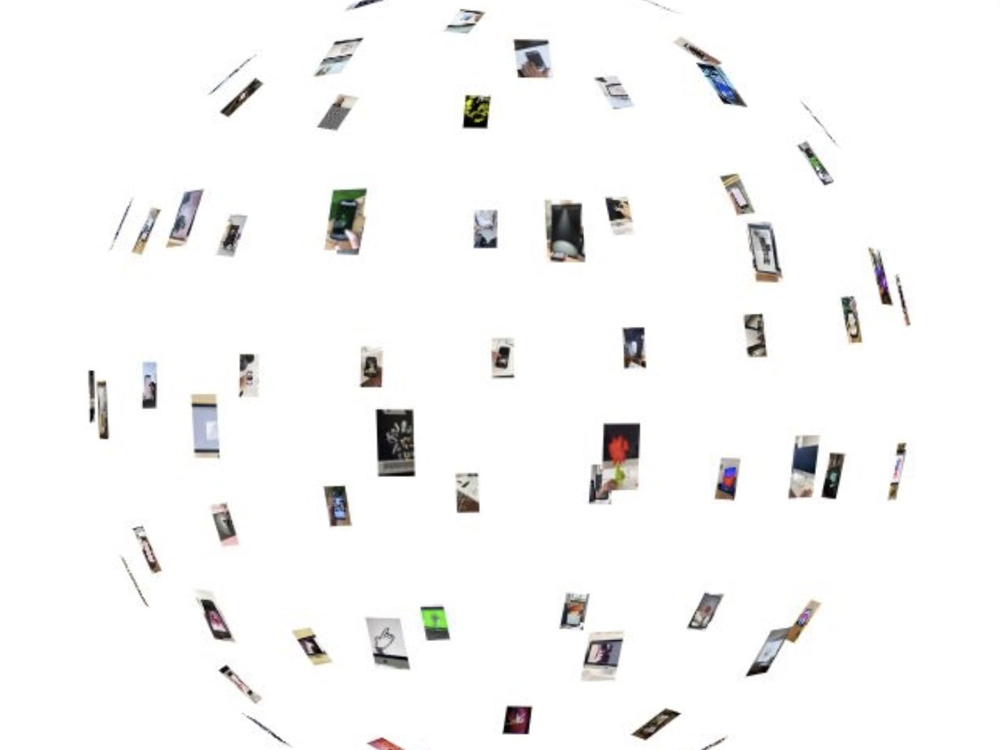 | 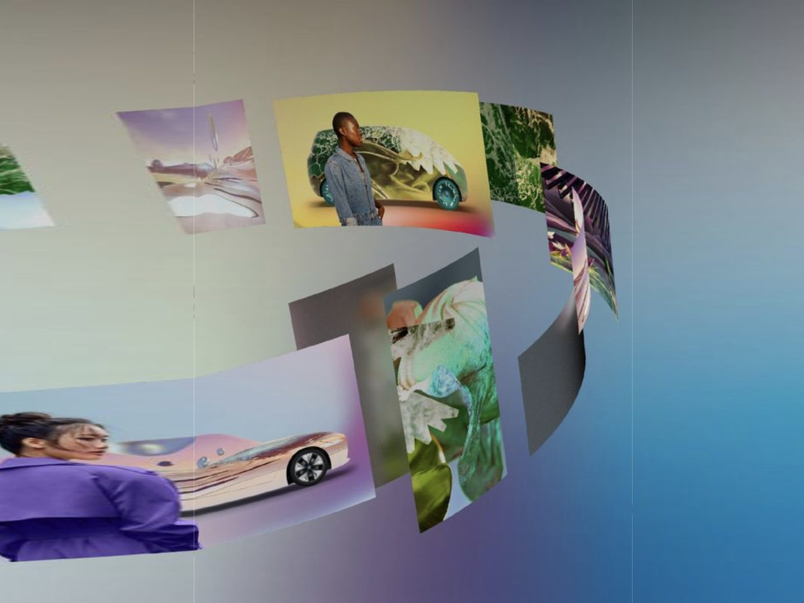 | 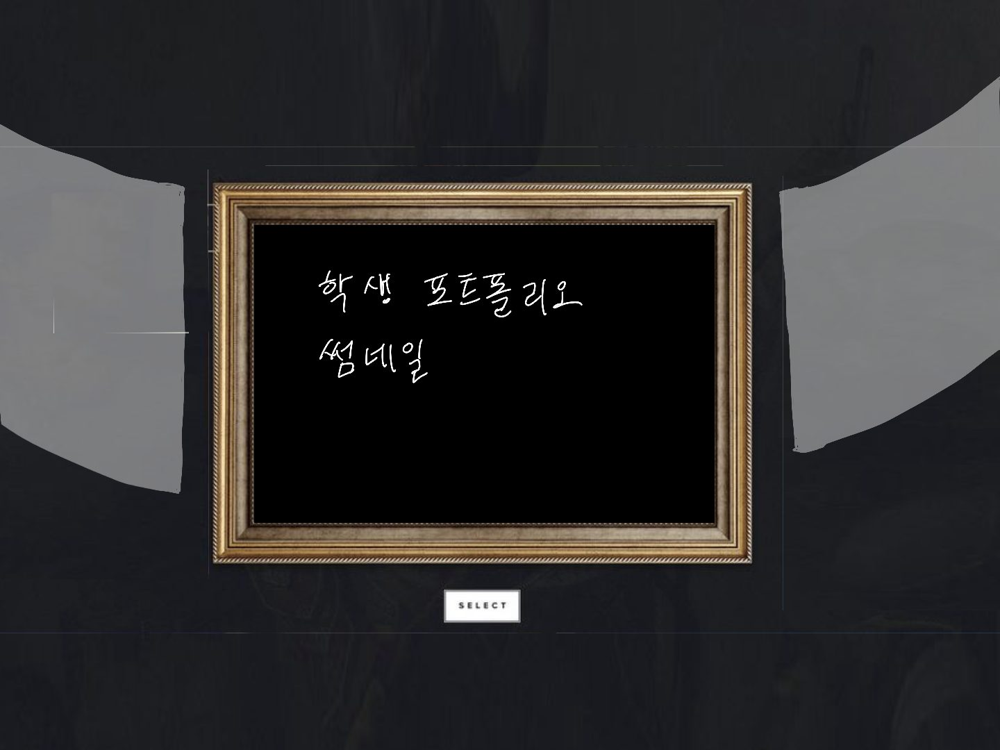 |

**장면 이야기**
학생들의 프로젝트 썸네일을 모아 둔 방이에요. 랜덤으로 볼 수 있어요.
- ①: 하얀 공간에 작은 썸네일들이 공 모양으로 떠 있어요.
- ②: 썸네일들이 리본처럼 휘어진 띠를 따라 돌아요.
- ③: 짙은 방 가운데 금 액자 하나, 그 안에 "학생 포트폴리오 썸네일", 아래 **SELECT** 버튼.

**추천: ③을 기본으로, ②를 "모아 보기"로**
- 기획서에서 특별전은 "짙은 배경과 작품 조명"이라고 했으니 ③이 딱 맞아요.
- 들어오면 금 액자에 **랜덤으로 한 명의 대표 작품**이 걸려요. [다른 작품] 버튼(또는 스크롤)을 누르면 액자 속 작품이 바뀌어요. [SELECT] → 학생 소개 창.
- ①은 썸네일이 수십 장일 때 예뻐요. 대표 작품은 **15장**뿐이라 공이 듬성듬성해 보일 수 있어요. 대신 ②처럼 15장을 띠로 둘러 "전체 보기"로 쓰면 좋아요.
- 모바일: 로비를 거치지 않고 메뉴에서 바로 들어올 수 있게 해요.
- 대표 작품 15점은 아직 받지 못했어요. 그 전까지는 회색 임시 카드로 만들어요.

---

## s8. 학생 리스트

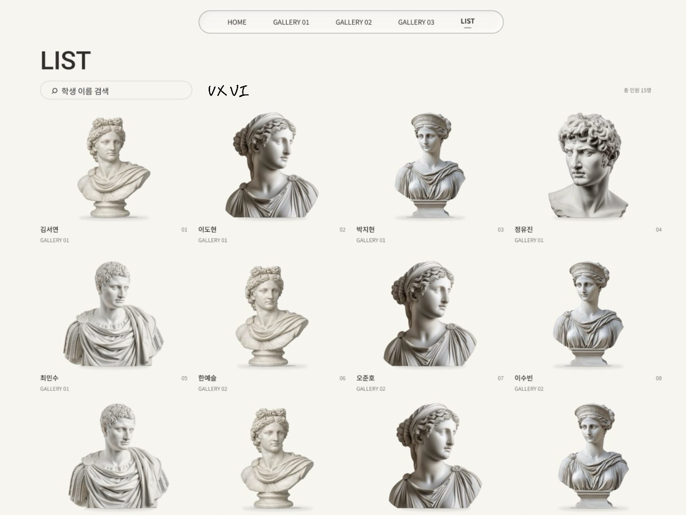

**장면 이야기**
밝은 크림색 바탕에 위쪽 둥근 메뉴(HOME · GALLERY 01 · GALLERY 02 · GALLERY 03 · LIST), 큰 제목 "LIST", "학생 이름 검색" 칸, 오른쪽에 "총 인원 15명". 아래에 석고상 사진 카드가 4줄로 놓이고, 카드마다 이름·번호·갤러리 이름이 있어요.

**구현 메모**
- 그림 속 이름(김서연, 이도현 …)은 **예시 이름**이에요. 실제 15명 데이터(`js/data.js`)로 바꿔요.
- 기획서대로 **분야 선택**(전체 / UX/UI / Visual)을 검색 칸 옆에 추가해요. (손글씨 "UX VI" 자리가 이 버튼 자리로 보여요.)
- 카드 클릭 → 학생 소개 창 → 포트폴리오 새 탭. 닫으면 **검색어와 스크롤 위치가 그대로**.
- 3D가 안 켜지는 컴퓨터에서도 이 목록은 꼭 보여야 해요(3D 실패 시 대피소).
- 모바일: 카드 2줄, 검색은 위에 고정.

---

## 모든 장면에 공통으로 필요한 것

- 어디서든 **로비**와 **목록**으로 돌아가는 버튼.
- 키보드만으로 전부 이용 가능 (Tab, Enter, Esc, 방향키).
- "움직임 줄이기" 설정 존중 (영상·카메라 이동 줄이기).
- 영상 건너뛰기.
- 3D가 실패하면: "3D를 불러오지 못했어요" + [다시 시도] + [목록으로 보기].
- 용량: 첫 화면 3~5MB, 전시관 하나 추가 10~20MB, 전체 1GB 이내. 필요한 것만 그때그때 불러오기.
- 배포: 알드라이브로 닷홈 `html` 폴더에 업로드, 계정 전체 20GB 미만.

---

## Claude Code 추천 플러그인·도구

이미 안내받은 5개(Playwright MCP, Context7, GitHub/gh, Figma MCP, frontend-design)를 장면별로 언제 쓰는지와, 같이 쓰면 좋은 것을 정리했어요.

| 도구 | 언제 쓰나 | 이 프로젝트에서 하는 일 |
|---|---|---|
| **Playwright MCP** | 모든 장면 확인 | 브라우저를 열어 스크롤·클릭하고 스크린샷을 찍어서 "두 번째 석고상이 반쯤 보이나?", "소개 닫으면 제자리인가?"를 직접 확인 |
| **Context7** | s4, s6 | Three.js 0.160, GSAP ScrollTrigger 최신 사용법을 찾아 틀린 코드를 줄임 |
| **GitHub / gh** | 매 단계 | 브랜치·PR 만들기, 시험 방 PR #1 이어서 작업 |
| **Figma MCP** | s4, s8 | 슬로건 SVG, 목록 화면 레이아웃·색·글꼴 값을 피그마에서 바로 가져옴 |
| **frontend-design** (Anthropic 공식 플러그인) | s5, s7, s8 | 흔한 "AI 느낌" 화면 대신 디자인 방향을 지키는 HTML/CSS 작성 |
| **Chrome DevTools MCP** (추가 추천) | s6, 배포 전 | 3D 화면의 프레임 속도(FPS), 불러온 파일 용량, 콘솔 오류를 측정 — "첫 화면 3~5MB" 확인에 좋아요 |
| **Higgsfield MCP** (추가 추천, 이미 계정에 연결됨) | s1~s3 | 나비·포스터·입구 영상과 기준 이미지 만들기 |
| **Notion MCP** (추가 추천) | 전체 | Claude Code가 이 스토리보드 노션 페이지를 직접 읽게 하기 |
| **/code-review** (기본 기능) | PR 올리기 전 | 바꾼 코드에 버그가 없는지 검사 |

설치 예시 (터미널에서 한 줄씩):

```bash
claude mcp add playwright -- npx @playwright/mcp@latest
claude mcp add chrome-devtools -- npx chrome-devtools-mcp@latest
claude mcp add --transport http context7 https://mcp.context7.com/mcp
```

플러그인(frontend-design 등)은 Claude Code 안에서 `/plugin`을 입력하고 목록에서 이름을 검색해서 설치하면 돼요.

---

## Claude Code에 붙여 넣을 프롬프트

> 사용법: 순서대로 하나씩 붙여 넣으세요. 각 단계 끝에 Claude Code가 스크린샷과 통과/실패 표를 보여 줘요. 그 표를 보고, 내 브라우저에서도 같은 동작(스크롤, 클릭, Esc)을 한 번 직접 해 본 다음 다음 단계로 가요. 각 단계는 새 브랜치 + PR 하나예요.

### 0단계 — 프로젝트 이해시키기 (처음 한 번)

```
이 저장소는 2026 폴리텍 정수캠퍼스 시각디자인과 졸업전시 웹사이트야. 주제는 "프레임을 넘어, 우리를 만나다".
HTML/CSS/JS(빌드 없음), Three.js 0.160(importmap CDN), GSAP 3.12.5 ScrollTrigger를 써. React로 바꾸지 마.
먼저 index.html, js/data.js, js/test-room.js, css/test-room.css, tests/ 폴더, 그리고 열린 PR #1(claude/v2-test-room)을 읽고
1) 지금 있는 화면 전환 방식, 2) 학생 데이터 구조, 3) 시험 방에서 이미 되는 것과 안 되는 것을 초등학생도 알 수 있게 정리해 줘.
코드는 아직 고치지 마. 파일은 CRLF 줄바꿈을 유지해야 해.
그리고 이 내용을 CLAUDE.md로 저장해서 다음부터 매번 읽게 해 줘.
스토리보드 정리 문서: docs/storyboard/README.md (이미지는 docs/storyboard/img/, 노션에도 같은 내용 있음)
```

### 1단계 — 시험 방 마무리 검증 (s6의 기초)

```
PR #1 시험 방(기둥 1개, 임시 석고상 3개)을 Playwright MCP로 직접 열어서 아래 5가지를 확인하고, 안 되는 것만 고쳐 줘.
1. 스크롤 아래로 → 곡선을 따라 앞으로, 위로 → 같은 길로 뒤로, 손을 멈추면 그 자리에 멈춤
2. 두 번째 석고상이 기둥 뒤에서 절반 보일 때 한 번 멈춤
3. 석고상 클릭/Enter → 학생 소개 창, 열려 있는 동안 비행 멈춤
4. 소개 닫기(Esc 포함) → 같은 비행 위치 + 같은 키보드 초점으로 복귀
5. prefers-reduced-motion일 때 카메라 이동이 짧고 부드럽게 줄어듦
각 항목마다 스크린샷을 찍고 통과/실패 표로 알려 줘. 기존 테스트(tests/test-room.cjs)도 돌려 줘.
```

### 2단계 — 두 전시관으로 확장 (s6, 추천안)

```
시험 방을 UX/UI 전시관과 Visual 전시관 두 개로 키워 줘. 방향은 "버전 1 공간 + 버전 2 타이포 연출"이야.
- 공간: 밝은 돌 회색 벽과 바닥, 아치와 기둥(로비와 같은 모양), 하얀 받침대 위 석고상. 단순한 도형(Box, Cylinder, Plane)으로 만들어서 가볍게.
- 빛: UX/UI관은 옆 창에서 들어오는 조금 따뜻한 빛, Visual관은 격자 천장에서 내려오는 조금 차가운 빛. 석고상에 그림자가 생기게.
- 길: 미리 정한 CatmullRomCurve3 곡선을 스크롤로 따라감. 기둥을 지날 때마다 다음 석고상이 서서히 드러남.
- 멈춘 자리에서 마우스를 움직이면 시점이 ±5도만 살짝 돌아감(1인칭 느낌). 터치에서는 끔.
- 석고상 앞에 멈추면 학생 이름이 큰 글자 + 가는 선으로 화면에 떠오름(SVG 선 그리기, s4 슬로건과 같은 선 스타일).
- 학생 목록은 js/data.js의 field 값('uxui'/'visual')으로 나눠. 지금은 room이 순서(i/5)로 정해져 있으니 field 기준으로 바꿔 줘. field가 빈 학생 4명은 전시관에서 빼고, 몇 명이 빠졌는지 콘솔에 알려 줘(목록 화면에는 그대로 보여야 해).
- 전시관 하나에 필요한 파일만 들어갈 때 불러오기(동적 import / 지연 로딩). 전시관 하나 추가 용량이 10~20MB를 넘지 않게 하고, 실제 용량을 표로 보여 줘.
- 1단계의 5가지 검사를 두 전시관 모두에서 Playwright로 다시 확인해 줘.
레이아웃 숫자(곡선 점, 석고상 위치, 빛 세기)는 파일 맨 위 설정 객체 하나에 모아서 내가 직접 고칠 수 있게 해 줘.
```

### 3단계 — 로비 (s5)

```
로비를 만들어 줘. 하얀 석조 벽에 아치 3개, 아치마다 둥근 등 하나.
왼쪽 "UX/UI의 방" → GALLERY 01, 가운데 "비주얼의 방" → GALLERY 02, 오른쪽 "스페셜룸" → GALLERY 03.
- 마우스를 올리면 그 아치의 등이 밝아지고 이름이 나타남. 클릭하면 그 아치 안으로 카메라가 날아 들어가며 전시관으로 전환.
- 같은 3개를 HTML 버튼으로도 만들어서 Tab/Enter로 고를 수 있게.
- 화면 위 고정 메뉴: HOME · GALLERY 01 · GALLERY 02 · GALLERY 03 · LIST (모든 화면 공통).
- 모바일(768px 이하)은 3D 대신 아치 카드 3장 + "전체 학생 바로가기" 버튼.
- 로비 첫 카메라 구도는 입구 영상 마지막 아치와 맞출 거라서, 카메라 위치·시야각을 설정 객체로 빼 줘.
Playwright로 데스크톱/모바일 스크린샷을 찍어 보여 줘.
```

### 4단계 — 슬로건 타이포 모션 (s4)

```
슬로건 "프레임을 넘어 / 우리를 / 만나다" 모션을 만들어 줘. 스토리보드 s4 이미지 5장 순서야.
- 글자와 선은 SVG 하나로. (피그마 링크를 주면 Figma MCP로 가져와 줘. 없으면 임시로 웹폰트 + SVG path로 만들어 줘.)
- 순서: ① 오른쪽에서 선이 들어오며 "프" → ② "레임을 넘어" 아래로 선이 지나 위로 꺾임 → ③ "우리를" 세로선·계단선 → ④ "만나다" 아래 선 → ⑤ 카메라가 뒤로 빠지며 세 줄 완성.
- 선은 stroke-dashoffset으로 그려지고, 선 끝은 회색 그라데이션으로 번짐. 카메라 이동은 SVG 그룹 transform(이동+확대).
- GSAP 타임라인 하나, 자동 재생 7초 정도 + [건너뛰기] 버튼. 끝나면 로비로 하얗게 전환.
- 움직임 줄이기: ⑤ 완성 그림만 1초 보여 주고 로비로.
Context7으로 GSAP 최신 사용법을 확인하고 작성해 줘.
```

### 5단계 — 오프닝 영상과 입장 (s1~s3)

```
오프닝을 만들어 줘. 영상은 나중에 힉스필드로 만들 거라 지금은 자리만 잡아 줘.
- assets/video/intro.webm(+ .mp4) 을 재생하는 전체 화면 <video>. 파일이 없으면 docs/storyboard/img/의 s1~s3 이미지를 순서대로 보여 주는 임시 버전.
- 영상이 입구(s3) 장면에 오면 마지막 2초를 반복 재생하고, 아래에 [입장하기] 버튼(HTML)이 나타남. 입구 주변이 빛나는 효과.
- [입장하기] → 짧은 화이트 페이드 → 4단계 슬로건.
- 오른쪽 위 [건너뛰기] 항상 표시(누르면 바로 로비). 한 번 본 사람은 다음 방문 때 건너뛰기 버튼이 먼저 강조.
- 움직임 줄이기: 영상 대신 입구 이미지 한 장 + [입장하기].
- 첫 화면 총 용량이 3~5MB 안인지 Chrome DevTools MCP(또는 Playwright 네트워크 기록)로 재서 알려 줘.
```

### 6단계 — 스페셜룸 (s7)

```
스페셜룸(GALLERY 03)을 만들어 줘. 스토리보드 s7-③ 방향이야.
- 짙은 배경, 가운데 금색 액자 하나, 위에서 작품을 비추는 스포트라이트 느낌.
- 들어오면 15명 중 한 명의 대표 작품(data.js의 work 필드, 지금은 모두 null)이 랜덤으로 액자에 걸림. 같은 작품이 연달아 나오지 않게.
- [다른 작품] 버튼, 스크롤, 방향키로 다음 랜덤 작품. [SELECT] → 학생 소개 창 → 포트폴리오 새 탭.
- [모아 보기]를 누르면 s7-② 처럼 15장이 휘어진 띠 모양으로 천천히 도는 화면.
- 대표 작품 이미지가 아직 없으니 이름이 적힌 회색 임시 카드로 만들어 줘.
- 모바일과 메뉴에서 로비를 거치지 않고 바로 들어올 수 있게.
- 작품 이미지는 보일 때만 불러오기(loading="lazy" 또는 필요할 때 텍스처 로드).
```

### 7단계 — 학생 리스트 (s8)

```
학생 리스트(LIST) 화면을 스토리보드 s8대로 만들어 줘.
- 크림색 배경, 큰 제목 LIST, "학생 이름 검색" 칸, 분야 선택(전체/UX/UI/Visual), 오른쪽 "총 인원 15명".
- 카드: 석고상 이미지, 이름, 번호(01~15), 분야 또는 갤러리 이름. 4열 → 태블릿 3열 → 모바일 2열.
- 그림 속 이름은 예시라서 실제 데이터(js/data.js) 15명을 써 줘. 없는 정보는 지어내지 말고 비워 둬.
- 카드 클릭 → 학생 소개 창 → 포트폴리오 새 탭. 소개를 닫으면 검색어, 분야 선택, 스크롤 위치가 그대로.
- 3D가 실패해도 이 화면은 꼭 열려야 해(3D 코드를 불러오지 않는 페이지).
- frontend-design 플러그인 원칙을 지켜서, 흔한 템플릿 느낌이 나지 않게 s8 이미지의 여백과 글자 크기를 따라 줘.
```

### 8단계 — 접근성·모바일·배포 점검

```
전체 사이트를 배포 전 점검해 줘.
1. 키보드만으로 오프닝→로비→전시관→소개→포트폴리오, 그리고 목록까지 갈 수 있는지
2. 움직임 줄이기 설정에서 모든 장면이 정상인지
3. WebGL을 끈 상태에서 "3D를 불러오지 못했어요 + 다시 시도 + 목록으로 보기"가 나오는지
4. 모바일(아이폰/안드로이드 크기)에서 터치 스크롤, 전체 학생 바로가기, 스페셜룸 바로 가기
5. 용량: 첫 화면, 전시관별 추가, 전체 공개본 크기를 표로. 목표는 3~5MB / 10~20MB / 1GB 이내
6. 닷홈 html 폴더에 그대로 올릴 수 있는 폴더 구조인지(절대경로 /로 시작하는 링크가 없는지)
Playwright와 Chrome DevTools MCP로 확인하고, 문제는 고친 뒤 결과를 통과/실패 표로 정리해 줘.
```

---

## 아직 정해지지 않은 것 (받으면 데이터 파일만 고치면 돼요)

- 분야 미정 4명: 김준서, 김우선, 조민영, 조예빈
- 포트폴리오 주소: 김예일, 송예준 (나머지 13명은 `js/data.js`에 있음)
- 학생 소개글 15명 (나중에 한 번에 받기로 함)
- 대표 작품 15점
- 힉스필드 영상 (s1~s3), 슬로건 피그마 원본 (s4)
